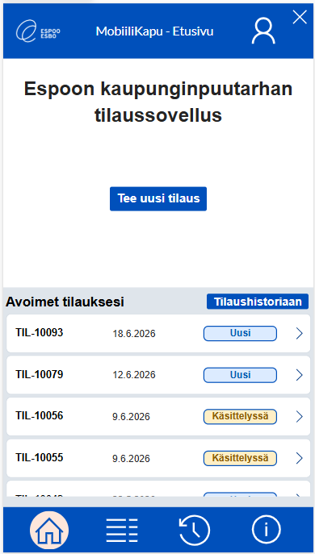

# MobiiliKapu – Order and Inventory Management System

## Project overview

MobiiliKapu is an order and inventory management solution developed using Microsoft Power Platform as part of a customer project.

The solution consists of two Power Apps Canvas applications:

- **Order Management App** – a mobile application for browsing products, placing orders, managing customer information and viewing order history.
- **Inventory Management App** – a desktop application for managing products, processing orders and maintaining inventory.

The applications share a SharePoint-based data model and utilize Power Automate workflows for automated background processes and notifications.

*Home screen of the mobile ordering application.*

## Technologies

- Microsoft Power Apps (Canvas Apps)
- Power Fx
- Microsoft Power Automate
- Microsoft SharePoint
- Microsoft Entra ID
- Microsoft Graph API

## My contributions

My work focused on application development, business logic, data management and process automation.

My contributions included:

- Development of the multi-step ordering process
- Application state management using global variables and collections
- Customer profile integration and dynamic form validation
- Order creation and data persistence
- SharePoint data model development and query optimization
- Automated email notifications
- User role and access management
- Error handling and logging
- Functional testing and technical documentation

## Technical highlights

### Application state management

The order creation process was redesigned to maintain order information in application memory throughout the ordering process. Data is written to SharePoint only after the user confirms the order.

This approach reduces unnecessary data writes and prevents abandoned orders from creating incomplete records during the ordering process.

### Data model and performance

The solution uses interconnected SharePoint lists to store orders, order items, customer profiles and product information.

Data retrieval was optimized by considering Power Apps delegation limitations and utilizing indexed columns and ID-based relationships.

### Process automation

Power Automate workflows support the order lifecycle by automatically sending email notifications based on changes in order status.

### Security and access control

Microsoft Entra ID groups and SharePoint permissions are used to manage access for different user roles. Additional data protection approaches were evaluated to address the limitations of direct SharePoint connections.

## Technical documentation

- [System architecture](docs/architecture.md)
- [Application logic](docs/application-logic.md)
- [Data model and performance](docs/data-model.md)
- [Process automation](docs/automation.md)
- [Security and access control](docs/security.md)
- [Testing and development](docs/testing-and-development.md)

## About this repository

This repository is a technical portfolio presenting selected aspects of my work on the project. It focuses on implementation decisions, technical challenges and solutions rather than distributing the original application or customer data.
