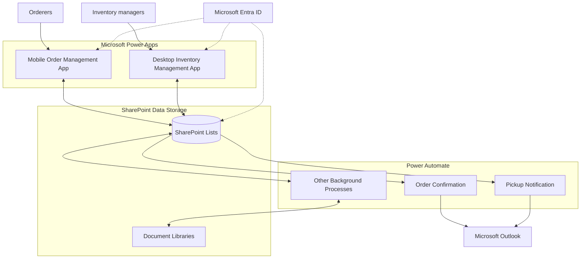

# System architecture

## Overview

MobiiliKapu consists of two Power Apps Canvas applications that share a common SharePoint-based data storage layer. Power Automate provides background processing and automated notifications, while Microsoft Entra ID supports identity and access management.

The solution was developed using standard Microsoft 365 connectors without requiring a separate database or premium connectors.

## Architecture diagram

## Application layer

The mobile application provides functionality for product browsing, order creation, customer profile management and order history.

The desktop application provides functionality for inventory management, product maintenance and order processing.

Application logic is implemented using Power Fx, including data retrieval, validation, state management and error handling.

## Data storage layer

SharePoint lists are used to store products, orders, order items, customer information, application settings and error logs.

Relationships between lists are maintained through ID-based references and application logic.

SharePoint document libraries are also used for reporting and product import templates.

## Automation layer

Power Automate cloud flows handle background processes, including event-driven email notifications based on order status changes.

## Identity and access management

Microsoft Entra ID groups are used to distinguish between user roles. Application-level functionality and SharePoint permissions are configured according to these roles.

## Deployment considerations

The system was developed in a separate development environment without a solution-based deployment model.

Environment-specific connections and configuration settings require adjustments when transferring the system to another environment.

Solution-based development was identified as a potential improvement for future application lifecycle management.

*The architecture diagram is a simplified reconstruction of the implemented system.*
