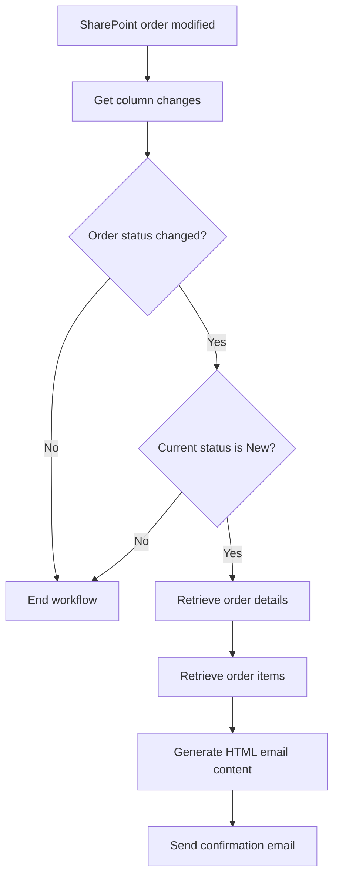

# Process automation

Power Automate is used to automate background processes and support the order lifecycle.

## Order confirmation workflow

An automated cloud flow sends an order confirmation email when an order status changes to New.

The workflow checks whether the order status column has changed, preventing unrelated updates from triggering additional confirmation emails.

Order details and order items are retrieved from SharePoint and used to dynamically generate an HTML-formatted confirmation email.

## Ready-for-pickup notification

A similar workflow notifies the customer when an order is ready for pickup.

The notification is triggered by a relevant order status change rather than by every modification to the order.

## Benefits

- Reduced manual communication
- Consistent customer notifications
- Automated processing of order information
- Separation of background automation from application logic
