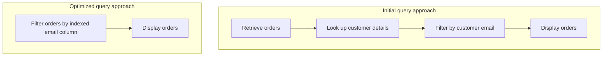

# Data model and performance

## SharePoint as a data source

The application uses SharePoint lists as its data storage layer, following the customer's technology requirements.

Separate lists are used for different entities, allowing order information, order items, customer profiles and product information to be managed independently.

## Data relationships

Relationships between lists are maintained using ID-based references and handled through application logic.

Order-specific customer information is stored separately from customer profiles. This allows historical order information to remain unchanged even when a customer updates their profile.

## Delegation and query optimization

During development, the original lookup-based relationships were redesigned to use ID-based references to address delegation limitations in Power Apps.

Indexed columns were also utilized to simplify frequently executed queries, such as retrieving orders associated with the current user.


Before:
```powerfx
Filter(
    AddColumns(
        Orders,
        CustomerEmail,
        LookUp(
            OrderCustomers,
            ID = OrderCustomerID,
            Email
        )
    ),
    CustomerEmail = User().Email
)
```

After:
```powerfx
Filter(
    Orders,
    CustomerEmail = User().Email
)
```
*Simplified Power Fx examples based on the original implementation.*

## Data consistency

SharePoint does not provide native multi-list transaction management.

To address this limitation, a draft order status is used during order creation. The order status is updated after the required data has been saved successfully.

This approach helps distinguish incomplete orders from successfully submitted orders.
