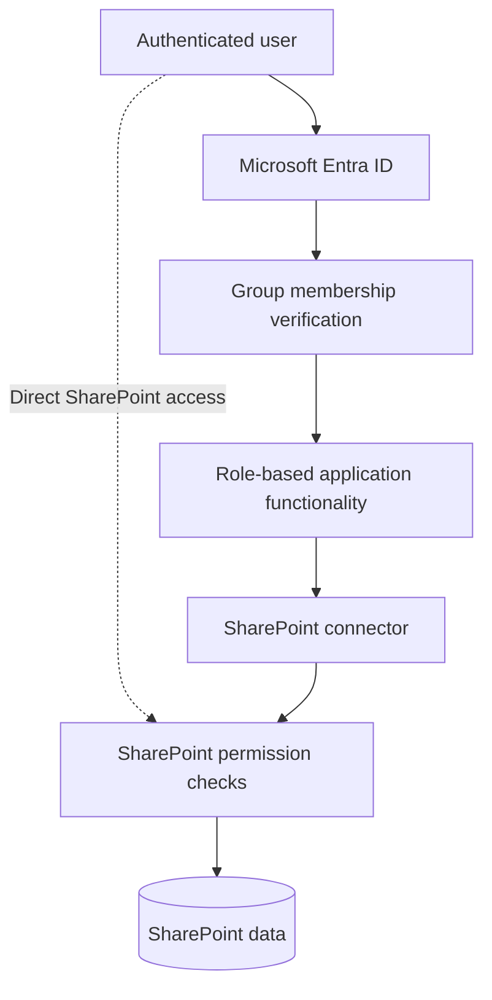

# Security and access control

## User roles

The system uses Microsoft Entra ID groups to distinguish between different user roles:

- Orderers
- Inventory managers
- Power users with additional ordering permissions

Application functionality and SharePoint permissions are configured according to these roles.

## Group membership verification

Group membership is checked within the application to determine which functionality should be available to the current user.

Group identifiers are retrieved from a configuration list instead of being hardcoded into application logic.

## Data source security

The applications use direct SharePoint connections under the current user's identity.

Filtering records within Power Apps improves usability but does not, by itself, prevent users from accessing data directly through SharePoint.

## Security considerations

During development, additional approaches to data protection were evaluated, including:

- SharePoint item-level permissions
- Custom permission levels
- Restricted access through Power Automate workflows

The advantages and limitations of these approaches were documented to support further development and deployment in the customer's environment.

*Application-level restrictions control available functionality, while SharePoint permissions determine actual access to the underlying data.*

## Security mechanisms and implementation status

| Security mechanism | Purpose | Implementation status |
|---|---|---|
| Microsoft Entra ID groups | User role management | Implemented |
| Group membership verification | Role-specific functionality | Implemented |
| Application-level filtering | Display relevant records | Implemented |
| SharePoint group permissions | Data source access control | Implemented |
| Item-level permissions | Restrict access to individual records | Evaluated |
| Custom permission levels | More granular access control | Evaluated |
| Restricted Power Automate access | Alternative data access architecture | Evaluated |

Application-level filtering does not replace data source security.
Additional security mechanisms were evaluated and documented
as potential improvements for the customer's production environment.
